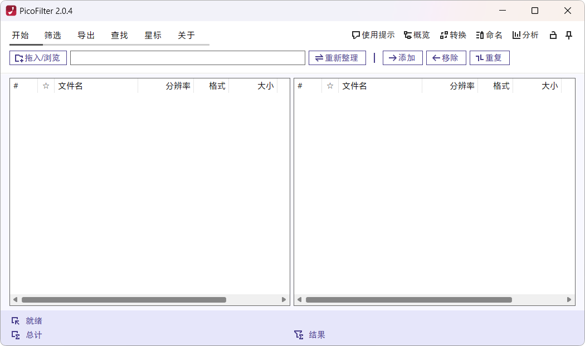
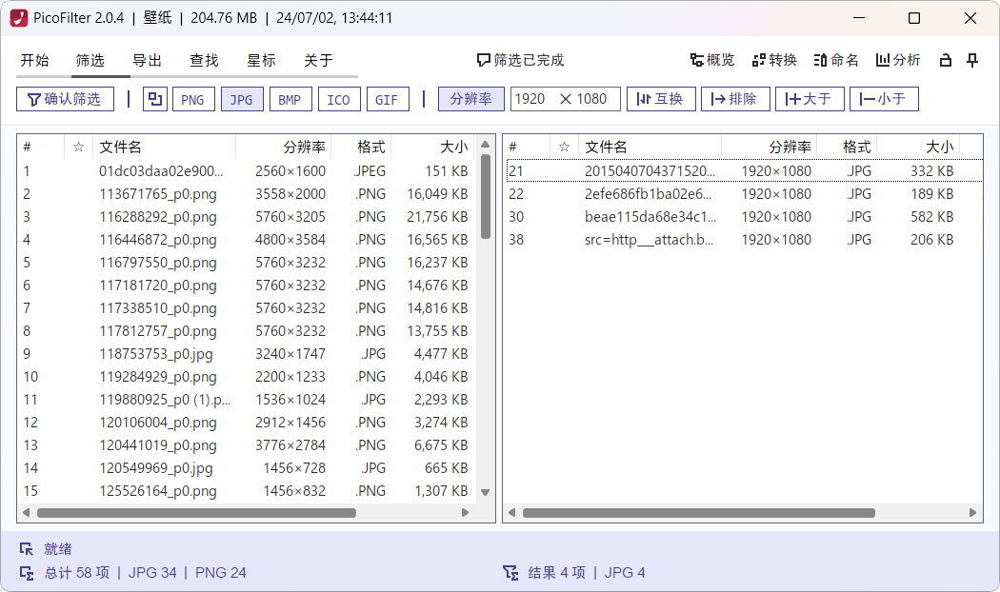
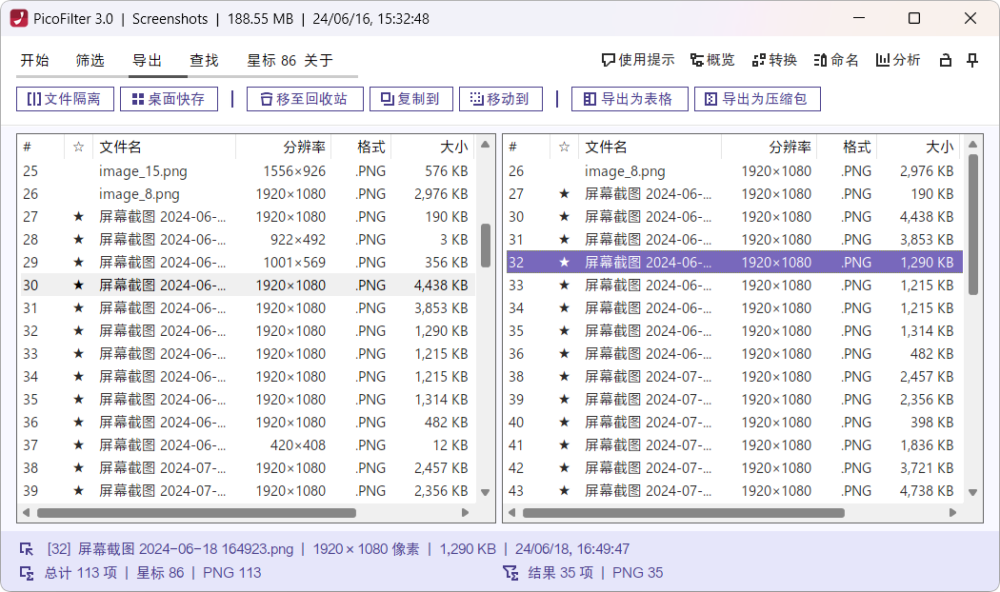
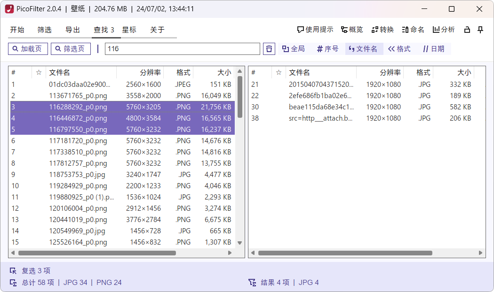
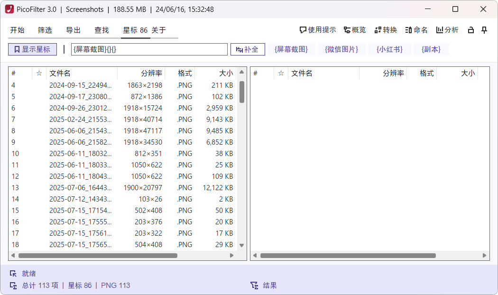
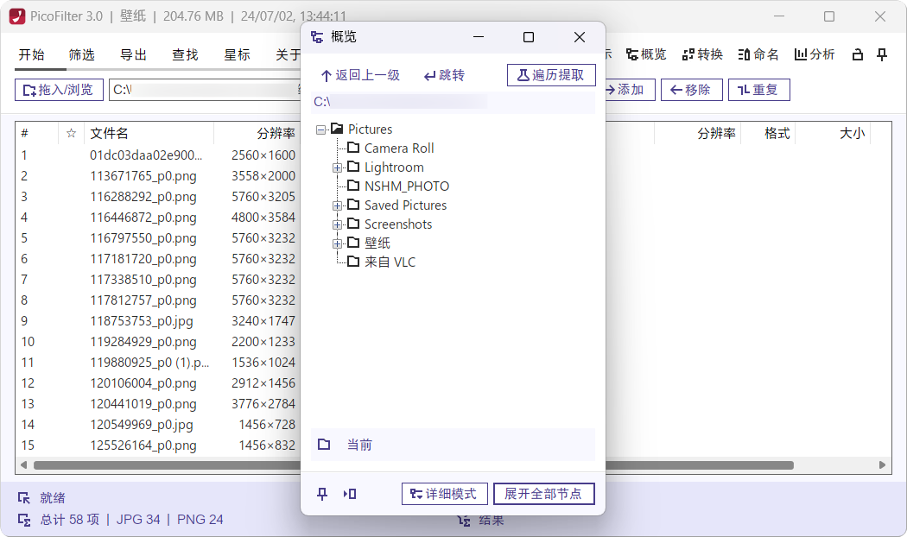
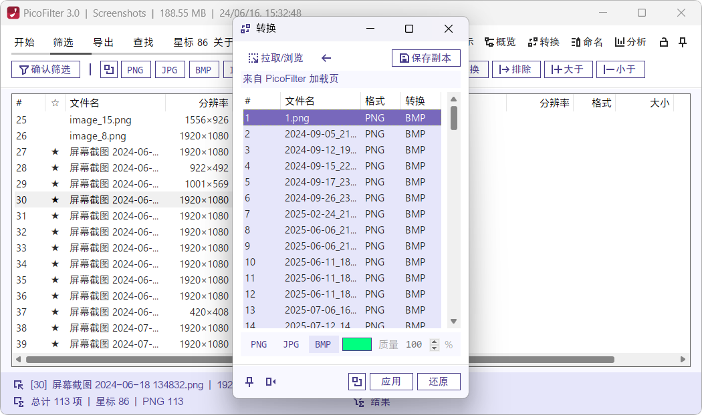
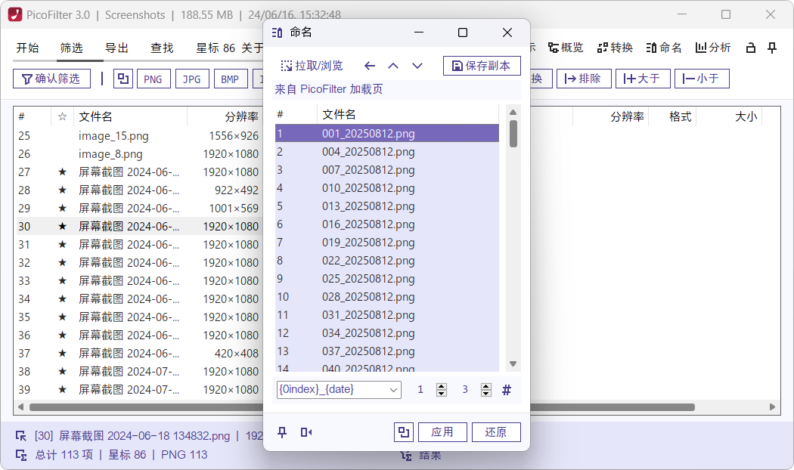
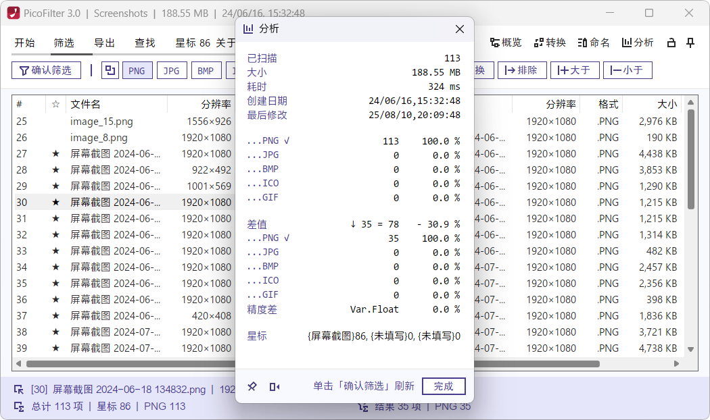
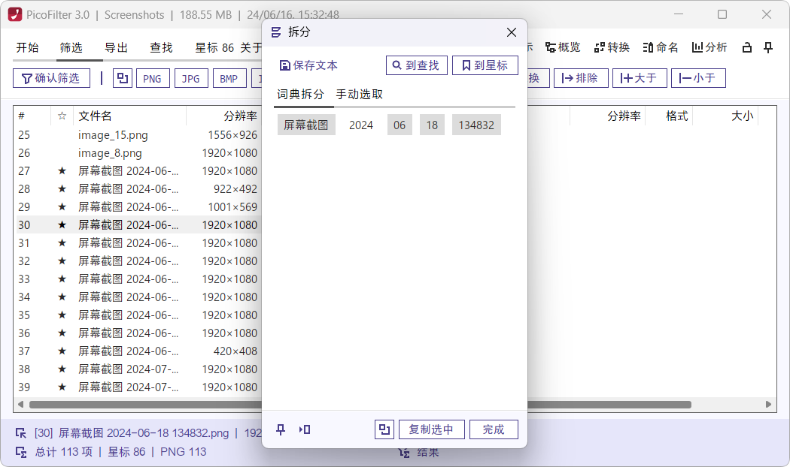

# PicoFilter

  <strong>图片筛选、整理、批量重命名与格式转换工具</strong>

  
  
  
  

PicoFilter 是一款基于 .NET Framework 开发的 Windows 图片整理工具，支持 JPEG、PNG、BMP、ICO 和 GIF 等常见图像格式。通过双列表管理、条件筛选、关键词标记和批量处理等功能，可以帮助用户快速整理图片文件，并完成批量重命名、格式转换、统计分析及结果导出。

## 目录

- [功能简介](#功能简介)
- [运行环境](#运行环境)
- [下载安装](#下载安装)
- [使用说明](#使用说明)
- [软件截图](#软件截图)
- [致谢](#致谢)
- [许可说明](#许可说明)
- [联系与反馈](#联系与反馈)
- [赞助支持](#赞助支持)

## 功能简介

| 功能模块 | 主要功能 |
| --- | --- |
| 图片管理 | 加载文件夹、双列表管理、排序、预览、重复图片检测 |
| 条件筛选 | 按图片格式和分辨率筛选，支持交叉筛选及多种分辨率匹配模式 |
| 查找 | 按序号、文件名、格式、修改日期等条件查找，支持循环定位 |
| 星标 | 使用正则表达式设置关键词，自动标记符合条件的文件 |
| 文件名拆分 | 拆分文件名中的词组，并快速发送到查找或星标功能 |
| 批量重命名 | 按序号、文件名、日期等规则批量生成新文件名 |
| 格式转换 | 批量转换 PNG、JPG、BMP、ICO，支持设置 JPG 质量及部分格式的背景色 |
| 结果导出 | 隔离文件、复制、移动、移至回收站、导出 Excel 表格及压缩包 |
| 文件夹概览 | 浏览文件夹结构、快速切换目录、遍历提取图像文件 |
| 统计分析 | 查看文件数量、格式分布、文件夹大小、加载耗时及筛选结果统计 |
| 窗体管理 | 统一管理程序窗口，支持置顶、停靠、平铺、叠层和居中等操作 |

## 运行环境

运行 PicoFilter 前，请确认满足以下要求：

- **操作系统：** Windows 7 或更高版本，32 位或 64 位环境。
- **运行库：** .NET Framework 4.7.2 Runtime。
- **显示分辨率：** 1024 × 768 像素或更高。
- **字体：** 方正黑体_GBK（英文名称：FZHei-B01）。

> [!IMPORTANT]
> 请在运行前安装所需的 .NET Framework 4.7.2 Runtime 和方正黑体_GBK 字体。分辨率低于 1024 × 768 时，程序布局可能出现异常。

## 下载安装

**GitHub Releases（主要发布渠道）**

[前往下载 PicoFilter](https://github.com/ReGoMark/PicoFilter/releases)

**蓝奏云（备用下载渠道）**

[点击下载](https://wwza.lanzouo.com/b0j0rzifa)

提取密码：`f5zh`

下载后解压文件，运行文件夹内的 `PicoFilter 2.0.x.exe` 即可。

## 使用说明

详细操作步骤、界面说明及使用注意事项，请参阅完整使用文档：

- [PicoFilter 2.0.x 使用说明（FlowUs）](https://flowus.cn/regmvks/share/e717713c-be23-4124-b364-878960e75a4e?code=98NZC1)

### 基本工作流程

1. **加载图片：** 选择包含图像文件的文件夹，也可以拖入文件夹或在路径输入框中输入路径。
2. **筛选与整理：** 在加载页中浏览、排序、查找和标记图片，将需要的项目添加到筛选页。
3. **批量处理：** 根据需求进行重命名、格式转换、复制、移动或其他操作。
4. **导出结果：** 将筛选结果保存为文件、Excel 表格或压缩包。

### 使用注意事项

- 图片被移动、删除或隔离后，建议点击「重新整理」刷新加载页，避免继续操作过期的数据。
- 「文件隔离」会将筛选页中的文件移动到当前目录下新建的隔离结果文件夹；「桌面快存」则会将文件复制到桌面。
- 批量重命名和格式转换支持保存副本，处理前请确认目标目录及文件命名规则。
- 星标功能使用正则表达式匹配关键词；设置标记词时应遵循程序规定的格式。
- 建议在执行批量移动、删除等操作前，确认筛选结果，必要时提前备份原始文件。

## 软件截图

### 主界面

  

### 图片筛选

  

### 结果导出

  

### 查找与星标

  

  

### 文件夹概览

  

### 格式转换与批量重命名

  

  

### 统计分析与文件名拆分

  

  

## 致谢

PicoFilter 的开发使用了以下开源项目与开发工具：

- [MetroFramework Modern UI](https://github.com/dennismagno/metroframework-modern-ui)：提供选项卡等界面组件及进度条指示器。
- [EPPlus](https://github.com/EPPlusSoftware/EPPlus)：提供 Excel 表格导出功能。
- [.NET Framework](https://dotnet.microsoft.com/zh-cn/download/dotnet-framework)：提供运行环境支持。
- [Microsoft Visual Studio 2022](https://visualstudio.microsoft.com/zh-hans/)：开发工具。

程序使用的字体资源包括：

- [方正黑体_GBK](https://www.foundertype.com/index.php/FontInfo/index/id/131)：默认显示字体。
- [Consolas](https://fonts.adobe.com/fonts/consolas)：等宽字符显示字体。
- [微软雅黑](https://learn.microsoft.com/zh-cn/typography/font-list/microsoft-yahei)：内容区默认显示字体。

感谢开源社区提供的工具、组件与技术支持。

## 许可说明

PicoFilter 的软件许可证请参阅仓库中的 [LICENSE](./LICENSE) 文件。

程序使用的字体及其他第三方资源可能适用独立的许可条款，其使用范围应以相应权利人的规定为准。

## 联系与反馈

如遇到问题、发现错误或有功能建议，欢迎通过以下方式联系：

- **邮箱：** regmvks@outlook.com
- **哔哩哔哩：** [ReGoMark](https://space.bilibili.com/220248940)
- **问题反馈：** [GitHub Issues](https://github.com/ReGoMark/PicoFilter/issues)

## 赞助支持

如果 PicoFilter 对你有所帮助，欢迎通过赞助支持后续开发与维护。

每一份支持都是持续改进软件的动力，感谢大家的关注与支持！

  

---

  PicoFilter · ReGoMark

